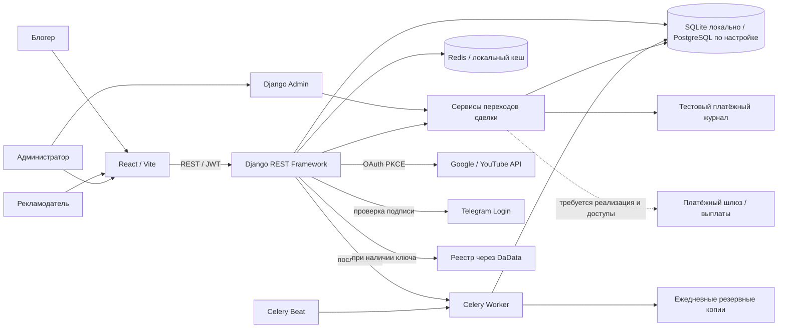
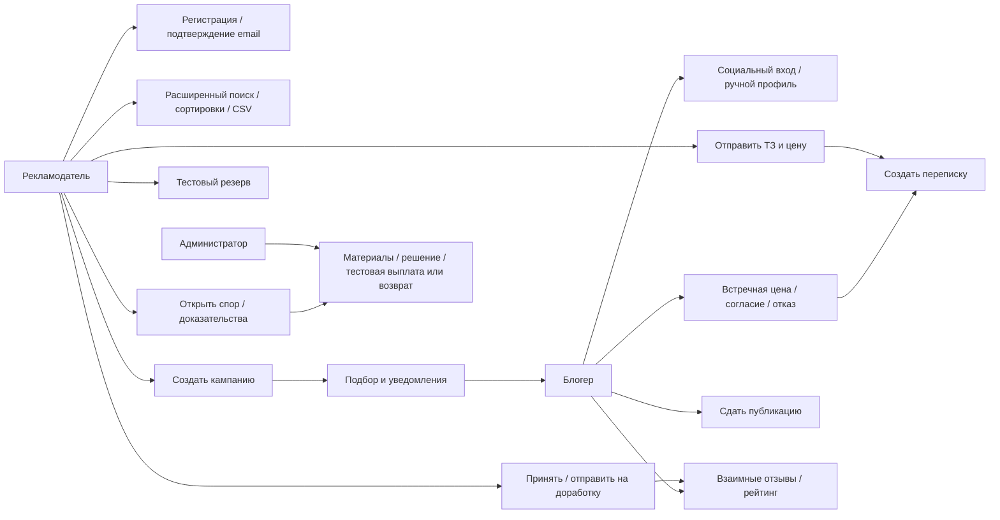
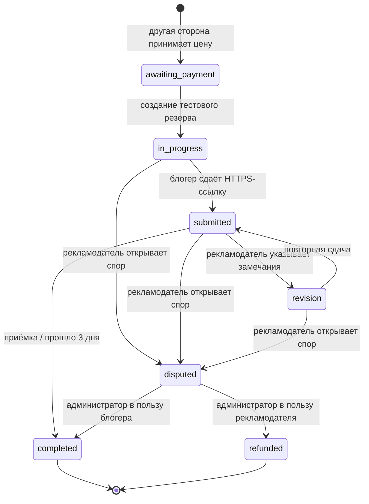
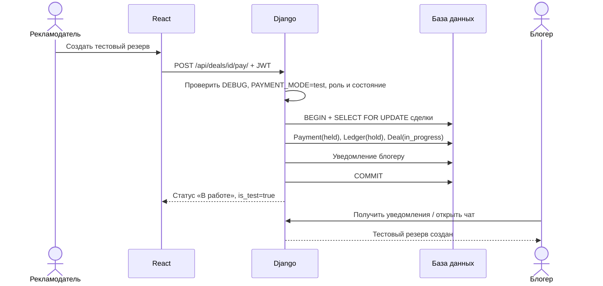

# Архитектура и актуальные UML

Исходные схемы описаны в лабораторных 1, 2 и 4. Ниже — актуализация относительно реализованной версии. Провайдеры и операции, которые ещё требуют подключения или реализации, отмечены отдельно; модель платёжного резерва не является банковским escrow.

## Компоненты (лабораторная 4)

## Варианты использования (лабораторные 1–2)

## Состояния сделки

## Последовательность оплаты: фактически реализованная версия

Исходная последовательность лабораторной 4 с redirect на шлюз и webhook остаётся требованием к платёжной интеграции. Она **не выдаётся за реализованную**. Подтверждение браузером не должно создавать реальный резерв; будущая реализация обязана проверять платеж у провайдера, сумму, валюту, принадлежность сделки и идемпотентность webhook.

## Ключевые решения

- Старые `User`, `BloggerProfile`, `Proposal` сохранены. Новые сущности добавляются миграциями; внешние ключи финансовых записей используют PROTECT.
- Единые сервисы переходов вызываются из API, админки и фоновых заданий. Для PostgreSQL блокируется строка сделки; уникальные ограничения предотвращают повторные проводки одного вида и отзывы одного автора.
- SQLite оставлена по умолчанию для сохранения локальной базы. PostgreSQL включается только явно, после экспорта и проверки переноса.
- JWT короткоживущий, refresh вращается и может быть отозван. Социальный обмен защищён одноразовым состоянием и CSRF; JWT не помещаются в URL.
- Файлы ТЗ и доказательств не публикуются через `/media/`. Скачивание требует участия в сделке или прав администратора и принудительного attachment.
- Антифрод сейчас проверяет аномалии самозаявленных метрик. Отсутствие аномалии не переводит профиль в «проверен» и не доказывает отсутствие ботов.
- Данные OAuth-токенов не сохраняются в базе. Повторный импорт выполняется при подключении YouTube; постоянный фоновый импорт требует согласованной политики хранения и обновления токенов.
