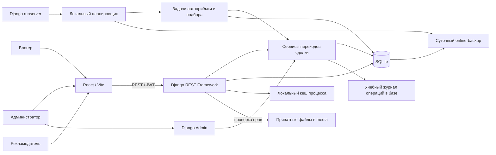
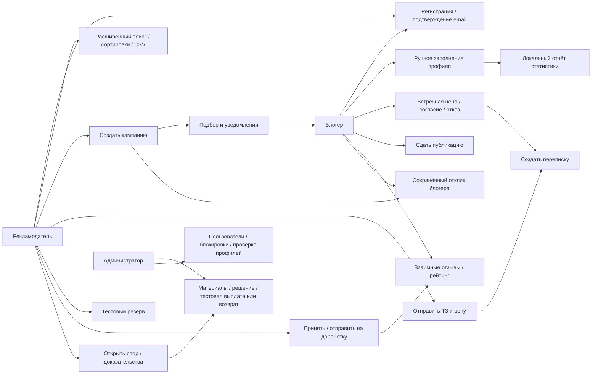
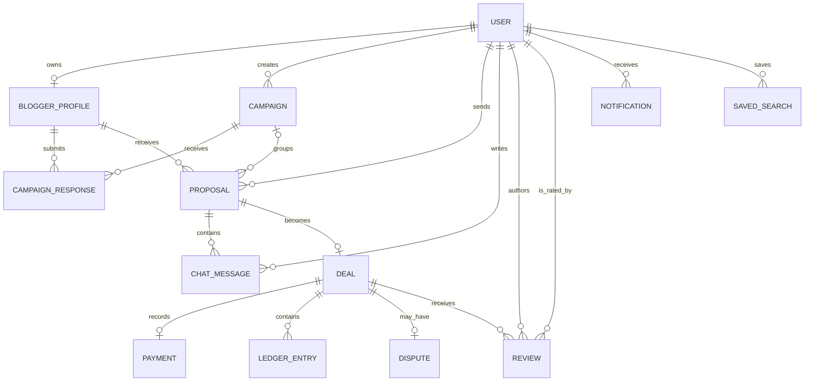
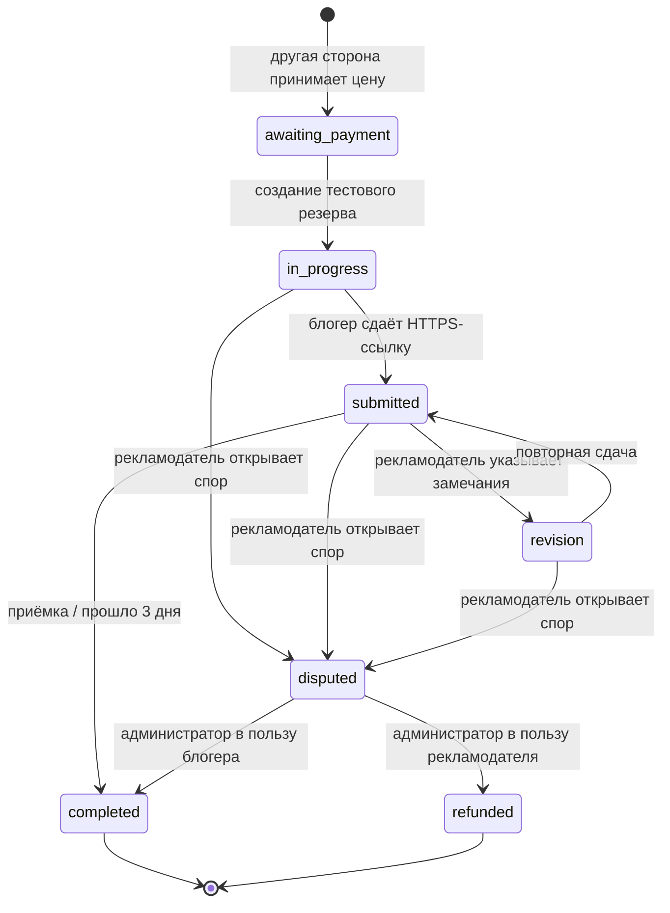

# Архитектура и схемы финальной учебной версии

Актуализировано 17.11.2026. Реализация находится в `main`. Схемы ниже описывают фактический автономный запуск с `EDUCATIONAL_MODE=true`, а не первоначальный production-план из лабораторной №4. Согласованные требования — в [educational-scope.md](educational-scope.md).

Внешние OAuth/API, реестр и банковские операции исключены из учебного объёма. Это не незавершённые ветви текущей архитектуры. Их сохранённые адаптеры отключены учебным режимом; модель тестового резерва не является банковским escrow. Исходные лабораторные остаются архивом проектирования.

## Компоненты локального запуска



React обращается к API по HTTP. API проверяет JWT/сессию, роль и принадлежность объекта. Модели и сервисы сохраняют результат в SQLite; интерфейс отображает ответ. `runserver` запускает локальный планировщик один раз в рабочем процессе, а задачи выполняются без отдельного брокера. Уведомления хранятся в базе и читаются интерфейсом периодически.

| Компонент | Фактический статус |
|---|---|
| React/Vite, Django REST API, SQLite | Основной учебный запуск |
| Локальный кеш, планировщик, директории media/backups | Основной учебный запуск |
| PostgreSQL | Необязательное подключение; проверяется CI, автоматический перенос SQLite не выполняется |
| Redis/Celery Worker/Beat | Необязательный инфраструктурный вариант вне основного учебного режима; не требуется для защиты |
| Google/YouTube/Telegram, DaData, SMTP и реальные платежи | Исключены из учебной приёмки; сетевые адаптеры заблокированы учебным режимом |

## Карта пользовательских сценариев

Ниже сценарии исходных лабораторных 1–2 приведены к согласованному учебному объёму. Диаграмма Mermaid показывает связи действий; исходные UML-материалы хранятся в `docs/requirements`.



## Основные связи данных



Имена на схеме соответствуют моделям в `users/models.py` и `catalog/models.py`. Связь кампании с предложением необязательна. `SocialIdentity` сохраняется в схеме базы для совместимости отключённых адаптеров и не участвует в учебных сценариях. Картинка `docs/images/er-diagram.png` относится к раннему этапу проектирования; актуальная схема данных приведена здесь.

## Состояния сделки



## Последовательность создания учебного резерва

```mermaid
sequenceDiagram
    actor A as Рекламодатель
    participant UI as React
    participant API as Django
    participant DB as База данных
    actor B as Блогер
    A->>UI: Создать тестовый резерв
    UI->>API: POST /api/deals/id/pay/ + JWT
    API->>API: Проверить DEBUG, PAYMENT_MODE=test, роль и состояние
    API->>DB: Транзакция; блокировка строки при PostgreSQL
    API->>DB: Payment(held), Ledger(hold), Deal(in_progress)
    API->>DB: Уведомление блогеру
    API->>DB: COMMIT
    API-->>UI: Статус «В работе», is_test=true
    B->>API: Получить уведомления / открыть чат
    API-->>B: Тестовый резерв создан
```

Исходная последовательность лабораторной 4 с redirect на шлюз и webhook исключена из согласованной учебной приёмки. Вместо неё работает приведённая локальная последовательность с тестовым журналом. Реальный резерв и банковский escrow не заявляются.

## Ключевые решения

- Старые `User`, `BloggerProfile`, `Proposal` сохранены. Новые сущности добавляются миграциями; внешние ключи финансовых записей используют PROTECT.
- Единые сервисы переходов вызываются из API, админки и фоновых заданий. Для PostgreSQL блокируется строка сделки; уникальные ограничения предотвращают повторные проводки одного вида и отзывы одного автора.
- SQLite оставлена по умолчанию для сохранения локальной базы. PostgreSQL включается только явно, после экспорта и проверки переноса.
- JWT короткоживущий, refresh вращается и может быть отозван. Проверяются роль и принадлежность объекта; JWT не помещаются в URL.
- Файлы ТЗ и доказательств не публикуются через `/media/`. Скачивание требует участия в сделке или прав администратора и принудительного attachment.
- Локальная проверка статистики ищет аномалии самозаявленных метрик. Отсутствие аномалии не переводит профиль в «проверен» и не доказывает отсутствие ботов.
- В учебном режиме профиль заполняется вручную, социальный вход и импорт из YouTube/Telegram отключены. Внешние подключения не являются запланированным продолжением учебного проекта.

## Дополнения завершённой учебной версии

- `EDUCATIONAL_MODE=true` блокирует внешние адаптеры, скрывает социальный вход и заменяет отправку почты локальным подтверждением в интерфейсе. Даже Swagger использует локальные статические ресурсы.
- Локальный daemon-планировщик запускается вместе с runserver, выполняет автоприёмку/подбор/эвристики раз в минуту и суточный backup. В тестовом сервере планировщик отключён, чтобы сценарии были детерминированными.
- `CampaignResponse` сохраняет уникальный отклик блогера в базе. Кампания хранит возрастные ограничения; её подобранные профили и отклики доступны владельцу, а предложение может ссылаться на кампанию.
- Модерация доступна staff-пользователям в React. Блокировка хранится отдельно от неподтверждённого email, действия журналируются, администраторские аккаунты защищены от изменения через эту панель.
- Локальный отчёт качества содержит найденные аномалии, время проверки и источник данных. Автоматическая проверка не выставляет is_verified: подтверждение выполняет модератор.
